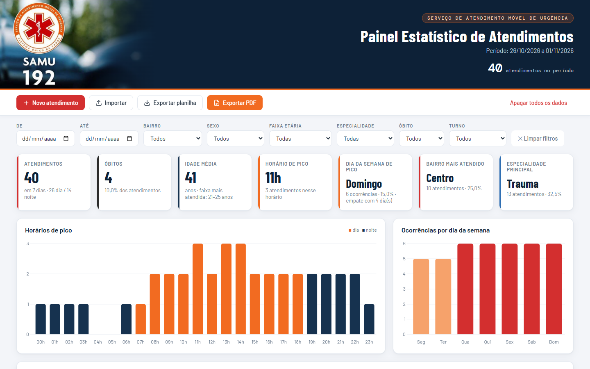
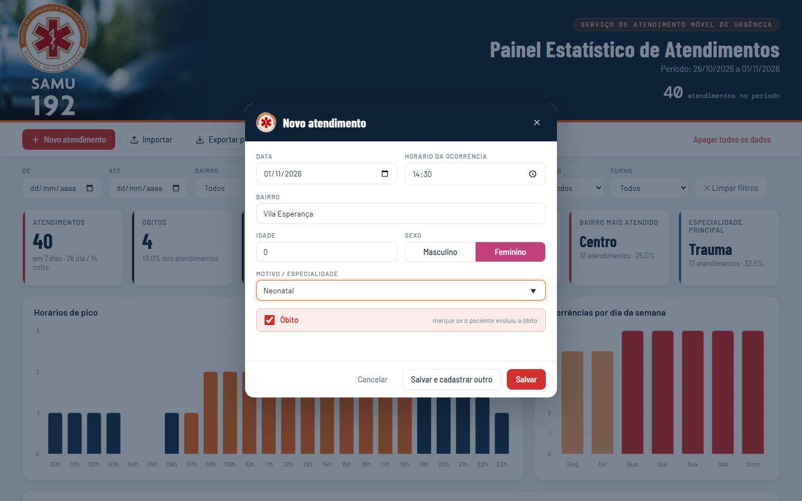
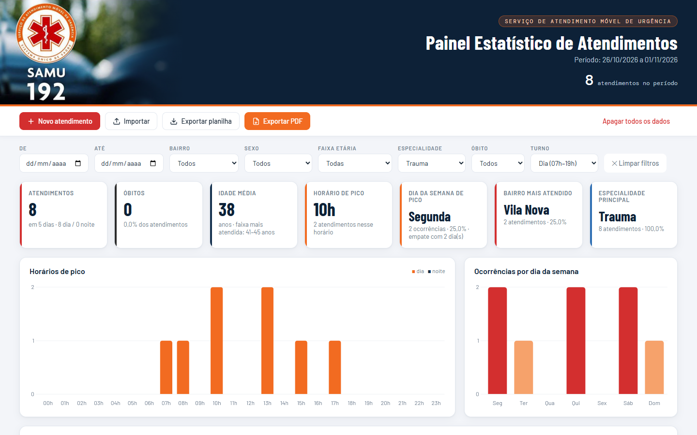
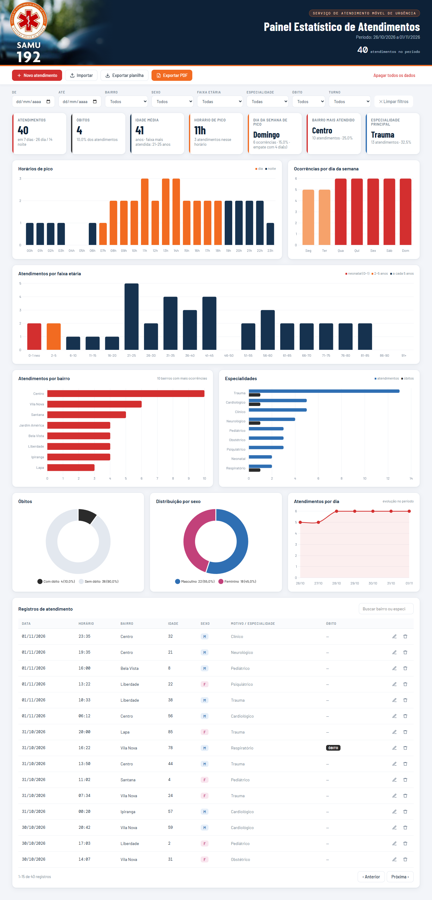
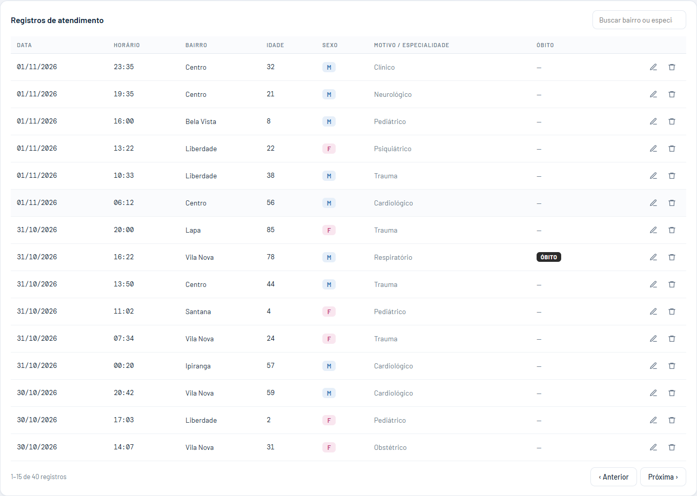
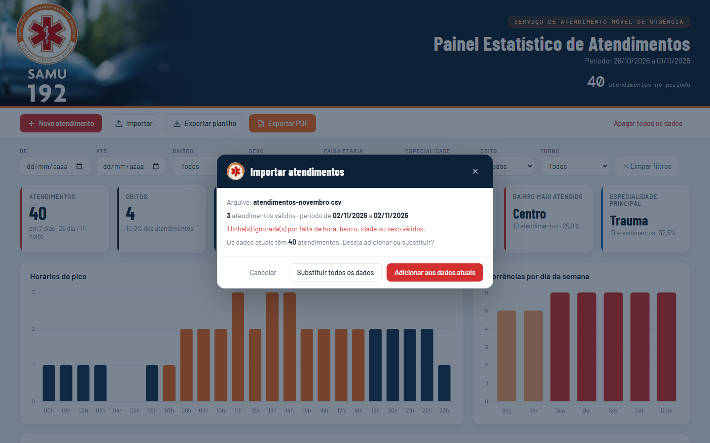
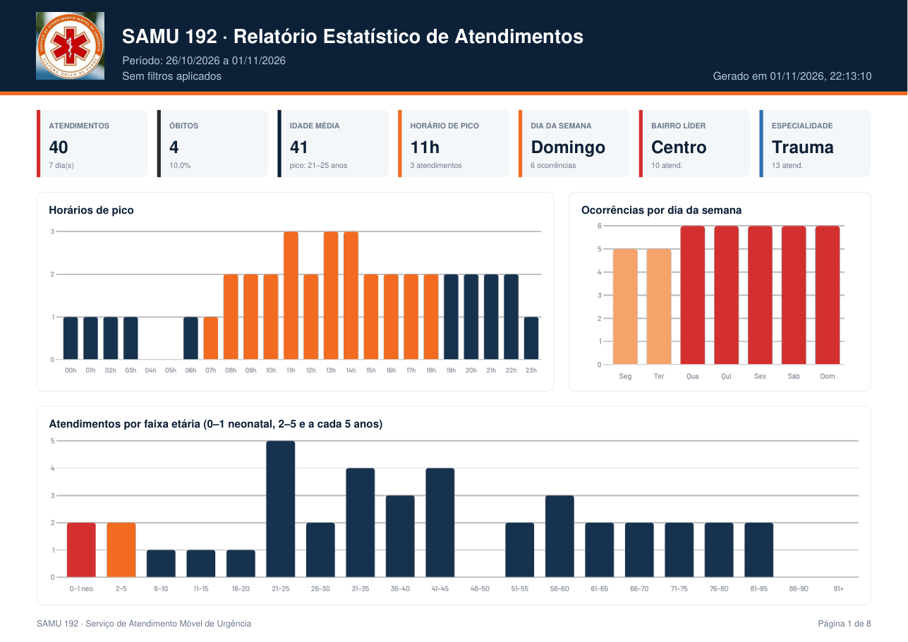
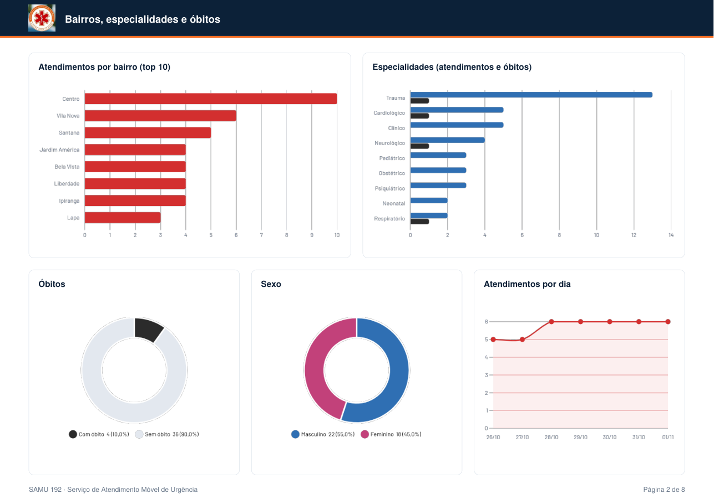
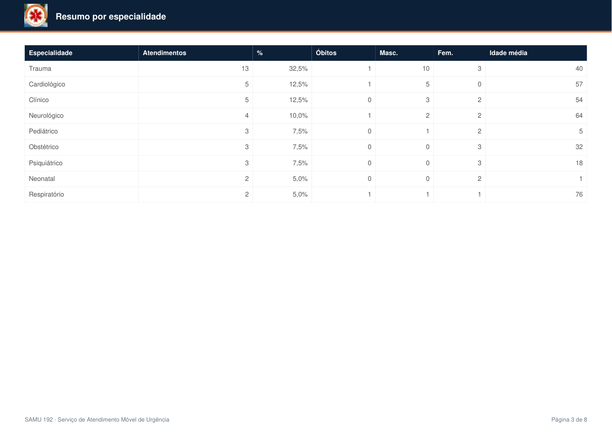
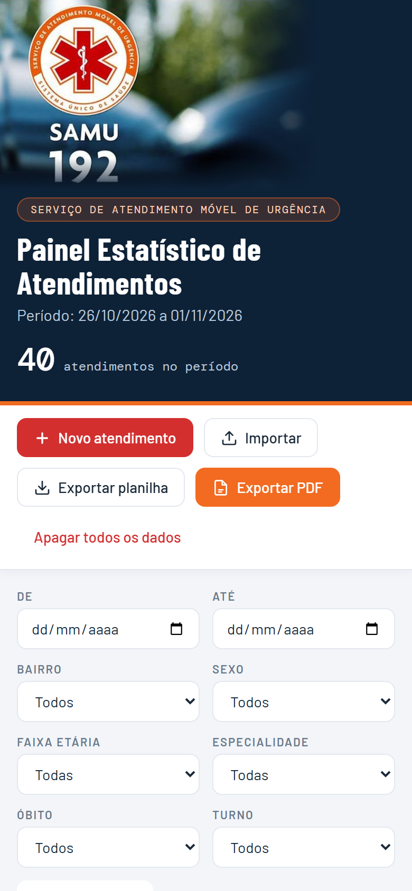

<div align="center">


# Painel Estatístico de Atendimentos · SAMU 192

Painel web para **lançar os atendimentos diários** do SAMU e **apresentar as métricas** de idade, bairro, horários de pico, dias da semana, especialidades e óbitos, com **relatório em PDF** e **planilha** para edição.



</div>

---

## Sumário

- [Funcionalidades](#funcionalidades)
- [Como usar](#como-usar)
  - [1. Lançar atendimentos](#1-lançar-atendimentos)
  - [2. Filtrar e analisar](#2-filtrar-e-analisar)
  - [3. Registros](#3-registros)
  - [4. Importar e exportar planilha](#4-importar-e-exportar-planilha)
  - [5. Relatório em PDF](#5-relatório-em-pdf)
  - [6. Celular](#6-celular)
- [Métricas calculadas](#métricas-calculadas)
- [Instalação](#instalação)
- [Onde ficam os dados](#onde-ficam-os-dados)
- [Testes](#testes)
- [Estrutura do projeto](#estrutura-do-projeto)

---

## Funcionalidades

| | |
|---|---|
| 📝 **Cadastro diário** | Data, horário da ocorrência, bairro, idade, sexo (M/F), motivo/especialidade e óbito |
| 📊 **Indicadores** | Atendimentos, óbitos, idade média, horário de pico, dia da semana de pico, bairro e especialidade principais |
| 📈 **8 gráficos** | Horários de pico, dia da semana, faixa etária, bairros, especialidades × óbitos, óbitos, sexo e evolução diária |
| 🔎 **Filtros** | Período, bairro, sexo, faixa etária, especialidade, óbito e turno (dia/noite) |
| 📄 **PDF** | Relatório com logo, indicadores, gráficos, resumos e lista completa |
| 📥 **Planilha** | Exporta CSV (abre no Excel), permite editar/acrescentar colunas e importar de volta |
| 📱 **Responsivo** | Funciona no computador, tablet e celular |
| 🐳 **Docker** | Sobe em qualquer máquina com um comando |

---

## Como usar

### 1. Lançar atendimentos

Clique em **Novo atendimento**. A data já vem preenchida com o dia atual e bairro/especialidade sugerem valores já cadastrados. Marque **Óbito** quando o paciente evoluir a óbito.

Use **Salvar e cadastrar outro** para lançar vários atendimentos em sequência sem fechar o formulário.



### 2. Filtrar e analisar

Todos os indicadores e gráficos respondem aos filtros. No exemplo abaixo: especialidade **Trauma** no turno **dia**.



Visão completa do painel com todos os gráficos:

<details>
<summary><strong>Ver painel completo</strong></summary>



</details>

### 3. Registros

Tabela com busca por bairro ou especialidade, paginação e botões para **editar** ✏️ e **excluir** 🗑️ cada atendimento. Óbitos aparecem destacados.



### 4. Importar e exportar planilha

- **Exportar planilha** gera um `.csv` que abre direto no Excel.
- Edite, corrija ou **acrescente colunas** (ex.: `unidade`, `desfecho`) — elas são preservadas.
- **Importar** mostra um resumo antes de aplicar e pergunta se deve **adicionar** aos dados atuais ou **substituir** tudo. Linhas incompletas são ignoradas e informadas.



**Formato da planilha** (separador `;` ou `,`):

```csv
data;hora;bairro;idade;sexo;especialidade;obito
02/11/2026;08:15;Centro;0;F;Neonatal;Não
02/11/2026;09:30;Vila Nova;34;M;Trauma;Não
02/11/2026;21:00;Lapa;67;F;Cardiológico;Sim
```

| Coluna | Obrigatória | Aceita |
|---|---|---|
| `data` | não (padrão: hoje) | `dd/mm/aaaa` ou `aaaa-mm-dd` |
| `hora` | sim | `08:15`, `8:15`, `8h` |
| `bairro` | sim | texto |
| `idade` | sim | número (0 a 120) |
| `sexo` | sim | `M`, `F`, `Masculino`, `Feminino` |
| `especialidade` | não | texto (também aceita `motivo`) |
| `obito` | não | `Sim`, `S`, `X`, `1` = óbito |

Também é possível importar `.json` (inclusive no formato da versão anterior do painel).

### 5. Relatório em PDF

**Exportar PDF** gera um relatório A4 paisagem com os filtros aplicados:

| Página | Conteúdo |
|---|---|
| 1 | Cabeçalho com logo, 7 indicadores, horários de pico, dia da semana e faixa etária |
| 2 | Bairros, especialidades × óbitos, óbitos, sexo e evolução diária |
| 3+ | Resumos por especialidade, bairro, faixa etária e dia da semana (com óbitos) |
| final | Lista completa de registros |

📎 [Baixar PDF de exemplo](docs/relatorio-exemplo.pdf)

| Página 1 | Página 2 | Resumos |
|---|---|---|
|  |  |  |

### 6. Celular



---

## Métricas calculadas

| Métrica | Como é calculada |
|---|---|
| **Faixa etária** | 0–1 ano (**neonatal**), 2–5 anos e depois **de 5 em 5 anos** (6–10, 11–15 … 86–90, 91+) |
| **Horário de pico** | Hora cheia (00h–23h) com mais ocorrências. Dia = 07h–19h, noite = 19h–07h |
| **Dia da semana** | Dia (seg–dom) com mais ocorrências; indica empate quando houver |
| **Bairro** | Ranking dos 10 bairros com mais atendimentos |
| **Especialidades** | Atendimentos e óbitos por especialidade |
| **Óbitos** | Total e percentual sobre os atendimentos |
| **Idade média** | Média das idades e faixa mais atendida |

---

## Instalação

### Com Docker (recomendado)

Pré-requisitos: [Git](https://git-scm.com/) e [Docker Desktop](https://www.docker.com/products/docker-desktop/).

```bash
git clone https://github.com/CarlosAlvesSantosJr/dashboard-atentimento.git
cd dashboard-atentimento
docker compose up -d --build
```

Acesse **http://localhost:8080**.

Se a porta 8080 já estiver em uso, escolha outra:

```bash
# Linux / macOS / Git Bash
PORTA=8085 docker compose up -d --build

# PowerShell
$env:PORTA=8085; docker compose up -d --build
```

| Ação | Comando |
|---|---|
| Parar | `docker compose down` |
| Atualizar após `git pull` | `docker compose up -d --build` |
| Ver logs | `docker compose logs -f` |

Para acessar de outros computadores da rede: `http://IP-DA-MAQUINA:8080`.

### Sem Docker

```bash
npm start   # http://localhost:8080
```

Ou simplesmente abra o `index.html` no navegador.

> A página carrega Chart.js e jsPDF via CDN, então o navegador precisa de acesso à internet.

---

## Onde ficam os dados

Os atendimentos são salvos **no navegador** de quem usa o painel (`localStorage`). Cada computador, navegador e endereço (ex.: `localhost:8080` × arquivo aberto direto) tem seus próprios dados.

Para **backup** ou para **levar os dados para outra máquina**:

1. **Exportar planilha** na origem.
2. **Importar** no destino → *Substituir todos os dados* ou *Adicionar aos dados atuais*.

> Na primeira abertura são exibidos dados de exemplo, que somem ao cadastrar o primeiro atendimento ou ao clicar em **Remover exemplos**.

---

## Testes

22 testes end-to-end com [Playwright](https://playwright.dev/), executados no Google Chrome:

```bash
npm install
npm test                                   # sobe um servidor local e testa
BASE_URL=http://localhost:8080 npm test    # testa o container Docker
```

| Grupo | O que é verificado |
|---|---|
| Carregamento | Dados de exemplo, indicadores, 8 gráficos, imagens |
| Regras de negócio | Faixas etárias, turno, dia da semana, normalização de datas/horas/sexo/óbito |
| Cadastro | Novo, salvar e cadastrar outro, validação, edição, exclusão, persistência, proteção contra HTML |
| Filtros | Sexo, óbito, especialidade, faixa etária, período, limpar, busca |
| Importação | CSV com `;` e acentos, mesclar, JSON antigo, arquivo inválido |
| Exportação | CSV ida e volta com colunas extras, PDF válido, aviso sem dados |
| Layout | Celular sem rolagem horizontal |

Sem Chrome instalado: `npx playwright install chromium` e `PW_CHANNEL=chromium npm test`.

Para regenerar as imagens desta documentação: `npm run screenshots`.

---

## Estrutura do projeto

```
├── index.html              # Aplicação completa (HTML, CSS e JavaScript)
├── assets/
│   ├── samu.jpg            # Imagem do cabeçalho
│   ├── samu-logo.jpg       # Logo (ícone, modais)
│   └── samu-img.js         # Imagens em base64 usadas no PDF
├── docs/
│   ├── images/             # Capturas de tela desta documentação
│   └── relatorio-exemplo.pdf
├── tests/
│   ├── dashboard.spec.js   # Testes Playwright
│   └── server.js           # Servidor estático local
├── scripts/screenshots.js  # Gera as imagens da documentação
├── Dockerfile              # Imagem nginx
├── nginx.conf
├── docker-compose.yml
└── playwright.config.js
```

**Tecnologias:** HTML/CSS/JavaScript puro · [Chart.js](https://www.chartjs.org/) · [jsPDF](https://github.com/parallax/jsPDF) + AutoTable · nginx · Docker · Playwright
